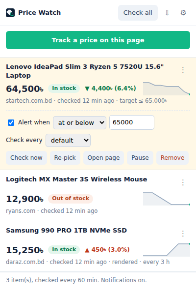
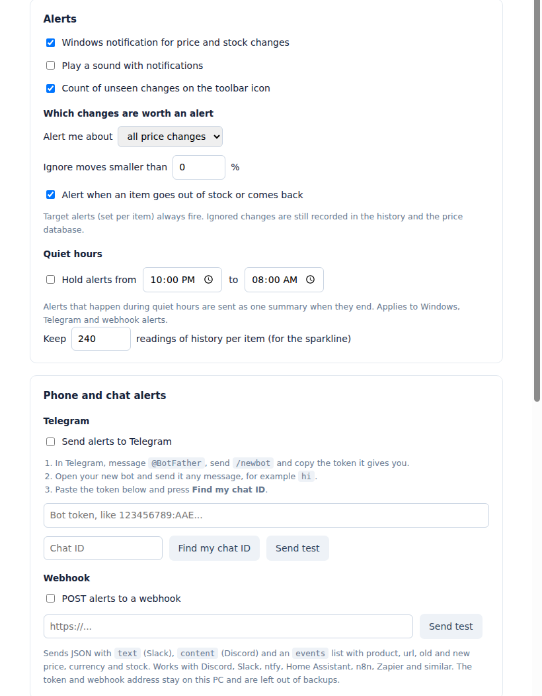

# Price Watch

[](https://github.com/MdAhsanulHimel/price-watch/actions/workflows/ci.yml)
[](https://github.com/MdAhsanulHimel/price-watch/releases/latest)
[](LICENSE)

**Track the price of anything on any website. Point at the price, click it, and
get told when it drops, rises, sells out or comes back in stock.**

A small Microsoft Edge and Google Chrome extension. No account, no server, no
tracking. It works on any shop (Star Tech, Ryans, Daraz, Amazon, AliExpress,
your local store) because you show it where the price is, instead of it
needing a built-in list of supported sites.

<p align="center">
  
</p>

## Features

- **Point and click.** Open a product page, press *Track a price on this page*,
  click the price. That's it.
- **Works when sites change.** It remembers several ways to find the price
  (CSS path, nearby anchors, `itemprop`, XPath, class scan), so a redesign
  rarely breaks it. If one does, **Re-pick** the price; the history stays.
- **Stock watching.** Alerts when an item goes out of stock or comes back,
  read from the shop's structured data or from words like "Out of stock",
  "Sold out" or "স্টকে নেই" next to the price.
- **Alerts where you want them.** Windows/macOS notifications, plus optional
  **Telegram** and **webhook** (Slack, Discord, ntfy, Home Assistant, n8n,
  Zapier).
- **Only the alerts that matter.** Drops only, ignore moves under X%, target
  prices ("tell me when it's at or below 65,000"), and quiet hours that save
  everything for one morning summary.
- **Price database you can open in Excel.** A CSV with Product name, Product
  Link, Date, Price and Stock. A row is added only when something actually
  changes, so it stays small.
- **Silent and fast.** Checks run in the background without ever opening a
  window or stealing focus. Pages that need JavaScript are rendered in a
  hidden frame inside the extension. Several items are checked in parallel.
- **Looks after itself.** Per-item check intervals, and pages that keep
  failing are checked less often until they recover, with one heads-up alert.
- **Private.** Everything stays in your browser. Site access is asked for one
  site at a time.

## Install

Price Watch is not in the Edge or Chrome store yet, so you load it yourself.
It takes a minute and stays installed.

1. Download **`price-watch-vX.Y.Z.zip`** from the
   [latest release](https://github.com/MdAhsanulHimel/price-watch/releases/latest).
2. Unzip it into a folder that can stay where it is, for example
   `C:\Tools\PriceWatch`. **Don't delete or move that folder later**: the
   browser loads the extension from it every time it starts.
3. Open `edge://extensions` (Edge) or `chrome://extensions` (Chrome).
4. Turn on **Developer mode**.
5. Click **Load unpacked** and choose the folder that contains `manifest.json`.
6. Pin it: click the puzzle-piece icon in the toolbar, then the pin or eye next
   to Price Watch.

**Updating:** unzip the new release over the same folder, then press
**Reload** on the Price Watch card in `edge://extensions`. Your items, history
and settings are kept.

> Prefer the source? `git clone` this repo and load the cloned folder the same
> way. There is no build step.

## How to use it

### Track a price

1. Open a product page and click the Price Watch icon.
2. Press **Track a price on this page**.
3. The first time on a new site, the browser asks whether Price Watch may read
   that site. Say yes. (If the popup closes when the prompt appears, just press
   the button again.)
4. Move the mouse over the page. Whatever is under the pointer is outlined and
   the number it found is shown. Click the price.
5. Check the value and name, then press **Watch it**. `Esc` cancels.

Click the element that holds the price itself, not a large box around it. The
confirm card warns you when your selection has a lot of extra text.

### In the popup

Each item shows its current price, stock status, the last change, a sparkline
and when it was last checked. Click an item's name (or the **⋮**) for more:

| Option | What it does |
|---|---|
| **Alert when at or below / above** | A target price. Fires once when reached, and re-arms after the price leaves the range. |
| **Check every** | This item's own interval. *default* uses the one in Settings. |
| **Check now** | Reads the page right away. |
| **Re-pick** | Opens the page and lets you click the price again. Use it when an item shows an error or a "loose match" warning. History is kept. |
| **Open page / Pause / Remove** | As named. Pausing keeps the history. |
| **Re-authorise** | Appears when the site permission is missing, e.g. after importing a backup on a new PC. |

The **⇩** button at the top downloads the price database. The **⚙** opens
Settings. The number on the toolbar icon counts changes you haven't seen yet.

### Settings

<p align="center">
  
</p>

- **Schedule:** how often to check (15 minutes to 1 day).
- **Alerts:** notifications, sound (off by default), badge, *all changes* or
  *drops only*, minimum change in %, stock alerts, quiet hours.
- **Phone and chat alerts:** Telegram and webhook, with test buttons.
- **Hard-to-read sites:** the optional background-tab fallback (see below).
- **Price database:** download or clear the CSV.
- **Backup:** export and import everything as JSON.

### Get alerts on your phone with Telegram

1. In Telegram, message [@BotFather](https://t.me/BotFather), send `/newbot`,
   follow the prompts and copy the **token**.
2. Open your new bot and send it any message, for example `hi`.
3. In Price Watch Settings, paste the token and press **Find my chat ID**.
4. Press **Send test**. You should get a message from your bot.

### Webhook

Each alert is sent as a `POST` with a JSON body like this:

```json
{
  "source": "price-watch",
  "text": "Price dropped: Lenovo IdeaPad Slim 3\n68,900৳ to 64,500৳  (DOWN 6.4%)\nhttps://...",
  "content": "same text, for Discord",
  "events": [
    {
      "type": "price",
      "title": "Price dropped",
      "product": "Lenovo IdeaPad Slim 3",
      "url": "https://www.startech.com.bd/...",
      "oldPrice": 68900,
      "newPrice": 64500,
      "currency": "৳",
      "stock": "in",
      "time": "2026-10-11T08:30:00.000Z"
    }
  ]
}
```

`type` is one of `price`, `stock`, `target` or `failing`. `text` works with
Slack incoming webhooks and `content` with Discord webhooks as they are.

### The price database (CSV)

```csv
Product name,Product Link,Date,Price,Stock
Lenovo IdeaPad Slim 3,https://www.startech.com.bd/...,2026-10-01 10:15,68900,In stock
Lenovo IdeaPad Slim 3,https://www.startech.com.bd/...,2026-10-06 16:00,66000,In stock
Lenovo IdeaPad Slim 3,https://www.startech.com.bd/...,2026-10-08 09:00,,Out of stock
Lenovo IdeaPad Slim 3,https://www.startech.com.bd/...,2026-10-10 11:45,64500,In stock
```

A row is written for an item's first reading, every price change, and every
switch between in stock and out of stock. Checks where nothing changed add
nothing. *Price* is empty when the shop hides the price while the item is out
of stock. Dates are in your computer's local time. The newest 20,000 rows are
kept.

## How it works

Every check tries the cheapest method first:

1. **Fetch.** Download the page's HTML and read the price from it. Fast and
   invisible. Works for most shops that build pages on the server.
2. **Hidden render.** If the price is drawn by JavaScript, the page is loaded
   in a sandboxed, invisible frame inside the extension's own offscreen
   document, given a few seconds, read, and thrown away. It never appears on
   screen, in the taskbar or in your tabs, and can't open pop-ups, show
   dialogs or play sound. Price Watch remembers which items need this.
3. **Background tab (optional, off by default).** For the rare site that
   refuses both, you can allow a muted, inactive tab in an existing window.
   It only runs while you've been away from the keyboard for two minutes, or
   when you press *Check now*, and it never opens a new window.

To find the price again on a later visit, the picker stores several
selectors and tries them in order:

1. the exact CSS path
2. a nearby stable anchor (an `id` or a `data-product-id`) plus a relative path
3. the `itemprop` attribute
4. an XPath
5. the same tag and classes, accepted only if exactly one candidate looks like a price
6. as a last resort, the single number on the page in the right range

1 to 5 are trusted. 6 is used but marked as a *loose match* in the popup so
you know to re-pick. If two numbers are equally plausible, Price Watch reports
an error instead of guessing.

Prices are parsed across formats: `81,000৳`, `$1,299.00`, `1.299,00 €`,
`₹1,23,456`, Bangla digits `৮১,০০০`, and more.

## Permissions

| Permission | Why |
|---|---|
| Access to a site (asked per site) | To read the price on the pages you track. Nothing is read until you approve a site, and you can revoke it in `edge://extensions` at any time. |
| `storage` | Saves your items, history, database and settings in the browser. |
| `alarms` | Runs checks on a schedule. |
| `notifications` | Price and stock alerts. |
| `scripting` | Runs the picker on the page when you press the button, and reads the hidden frame. |
| `offscreen` | The invisible document that parses pages and hosts the hidden frame. |
| `declarativeNetRequestWithHostAccess` | Lets the hidden frame load shops that normally refuse to be framed. Applies only to frames the extension itself creates, never to your normal tabs. |
| `tabs` | Reads the current tab's address when you start tracking, and opens a page when you click an alert. |
| `idle` | Lets the optional background-tab fallback wait until you're away. |

## Privacy

Price Watch has no server, no account and no analytics. Your items, price
history, database and settings live in the browser's local extension storage
on your computer. The only network requests are to the product pages you
track, plus Telegram or your webhook if you turn those on. The Telegram token
and webhook address are never included in exported backups.

## Limits worth knowing

- **The browser must be running.** Extensions can't run when Edge or Chrome is
  closed. If Edge's *Continue running background extensions and apps when
  Microsoft Edge is closed* setting is on, checks continue with no window
  open. After a long break, a catch-up check runs a few minutes after start.
- **15 minutes is the shortest interval.**
- **Some sites block automated reading.** Strong bot protection can serve a
  challenge page. The hidden render often gets through; the background-tab
  fallback is there for the rest.
- **Login-only prices** usually work because your cookies are sent, but a site
  that logs you out often will produce read errors.
- **Stock detection is best effort.** It relies on what the shop publishes or
  shows next to the price. When it can't tell, it shows nothing rather than
  guessing.

## Troubleshooting

| Symptom | Try |
|---|---|
| "No permission for ..." | Open the popup, open the item, press **Re-authorise**. |
| "The element could not be found" | The site changed. Use **Re-pick** on the item. |
| "Loose match" warning | Same: **Re-pick** to make it reliable. |
| An item says it failed several times and is checked less often | It recovers by itself once a check works. Re-pick if the site changed. |
| Telegram test fails | Check the token, send your bot a message, press **Find my chat ID** again, and allow access to `api.telegram.org` when asked. |
| Nothing happens on schedule | Make sure the browser is running. Check Settings for quiet hours. Paused items are skipped. |

## Development

```bash
git clone https://github.com/MdAhsanulHimel/price-watch.git
cd price-watch
npm install
npx playwright install chromium
npm run test:unit     # parsing, selectors, stock detection, CSV
npm run test:e2e      # loads the real extension in Chromium and drives it
npm run package       # builds dist/price-watch-vX.Y.Z.zip
```

The end-to-end test serves fake shops on localhost (one server-rendered, one
JavaScript-rendered that refuses framing), drives the picker with a real
mouse, changes prices and stock, and checks alerts, the database, quiet
hours, backoff, re-pick and that no tab or window is ever opened by a check.
On Linux without a display, run it under `xvfb-run -a`.

```
manifest.json        Extension definition (Manifest V3)
background.js        Service worker: schedule, reading, change detection, alerts
lib/pw-core.js       Price parsing, selectors, stock detection, CSV (shared everywhere)
picker/picker.js     The point-and-click overlay (shadow DOM)
offscreen/           Parses fetched HTML and hosts the hidden renderer
render/frame.js      Reads the price inside the hidden frame (only during a check)
popup/               The list, sparklines, per-item options
options/             Settings, database, backup
test/                Unit tests (jsdom) and end-to-end tests (Playwright)
scripts/package.mjs  Builds the release zip
```

See [CONTRIBUTING.md](CONTRIBUTING.md) for guidelines and the release process,
and [CHANGELOG.md](CHANGELOG.md) for what changed in each version.

## License

[MIT](LICENSE) © 2026 Md Ahsanul Islam
